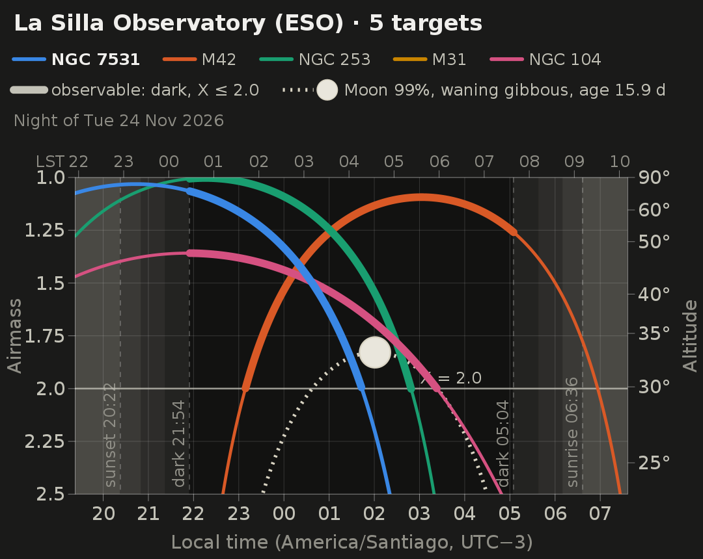
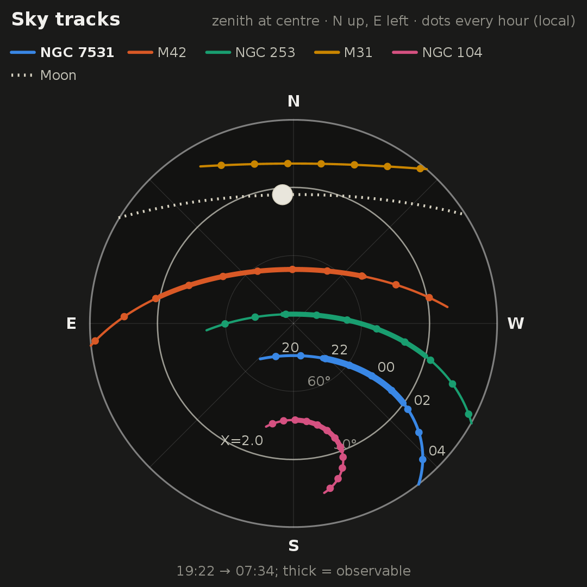
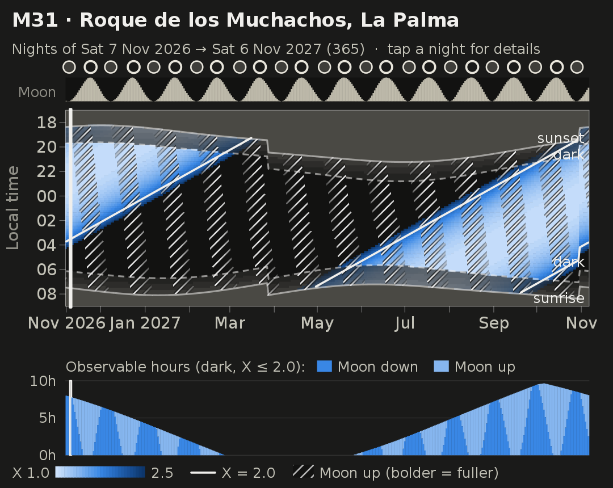
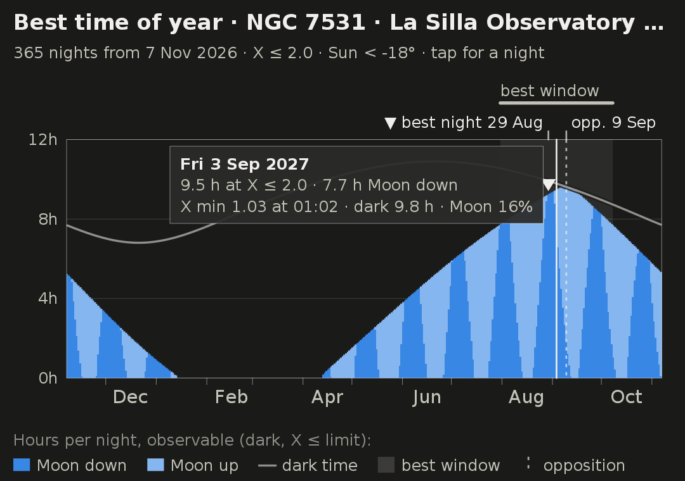
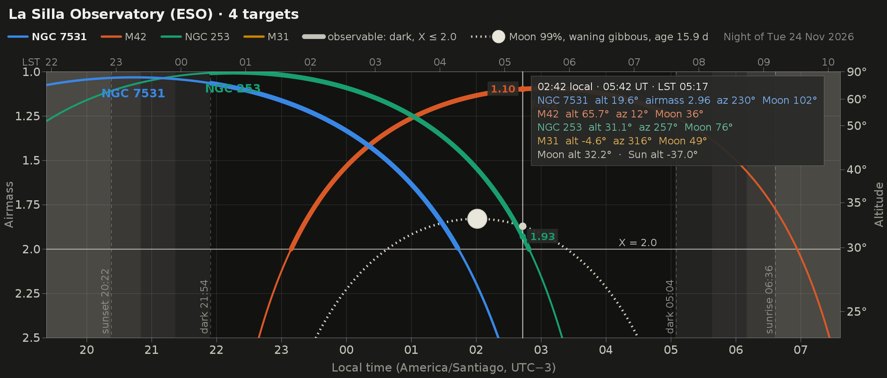

# ObsStarGet: Astronomical object Observability

An Android app for astronomical observability diagrams, designed and written by **Gaspar Galaz**. ObsStarGet is free and is made available to the astronomical community; see the *Disclaimer* in the app.

## Install it on your Android phone (free)

The app is not on Google Play; it is installed from this page. It needs Android 8.0 or newer.

1. On the phone, open the latest release: **<https://github.com/ggalazl/ObsStarGet/releases/latest>**
2. Under **Assets**, tap **`ObsStarGet-<version>.apk`** to download it.
3. Open the downloaded file (tap the download notification, or find it in *Files* / *My Files* → *Downloads*).
4. Android asks whether your browser may install apps: tap **Settings**, switch on **Allow from this source**, go back and tap **Install**.
5. If Google Play Protect warns about an app from an unknown developer, choose **More details → Install anyway**. The warning appears because the app does not come from Google Play.

On Samsung phones with **Auto Blocker** switched on (*Settings → Security and privacy → Auto Blocker*), the installation is blocked: switch Auto Blocker off, install, and switch it back on. On phones in Brazil, Indonesia, Singapore and Thailand, Android now asks for an extra step before installing apps from outside the app stores ("advanced flow").

**Updates:** download the newer APK from the same page and install it over the old one; your targets and settings are kept. To be told about new versions, watch this repository (*Watch → Custom → Releases*, with a GitHub account) or use the free app Obtainium.

## Feedback and suggestions

Comments, problems and ideas are very welcome:
* **Report a problem or suggest an improvement:** [open an issue](https://github.com/ggalazl/ObsStarGet/issues/new/choose) (a free GitHub account is needed). The app's **Feedback** button opens the same page.
* For a problem, please give the target, the site, the date and, if you can, a screenshot.

## What the app does

You give the app one or more targets (up to 8) and an observing site.

* **Targets:** a name or RA/Dec coordinates.
  * The built-in catalogue knows names such as M31, *Andromeda Galaxy*, M82, NGC 7531, *the Sombrero galaxy*, *Antennae*, *Pinwheel*, 47 Tuc, LMC, *Coma Cluster*, Vega and HD 172167. Generic words ("the", "galaxy", "nebula", "cluster") and shortened names are understood. When a short name fits several objects ("Cat's Eye", "Sculptor") the app lists them so you can choose.
  * Other names are looked up online, at the same time, in **NED** (NASA/IPAC Extragalactic Database) and **CDS Sesame** (SIMBAD, then NED and VizieR). Examples: *Cartwheel Galaxy*, *Hoag's Object*, Arp 220, UGC 10214, *Malin 1*, 1ES 1959+650. For galaxies NED's position is used; for stars SIMBAD's, with proper motion. If NED reports an ambiguous name, its candidates are offered; if the two services disagree by more than 15′, you choose. Names found online are remembered on the phone, so they work offline afterwards.
* **Site:** one of about 100 observatories (La Silla, Paranal, Roque de los Muchachos, Pic du Midi, …), coordinates you type in, or the device location.
* **Date window:** 1–366 nights.
* **Time scale** of the diagrams (*Options → Time axis*): the site's local time (with daylight saving), UT, the phone's time zone, or a fixed offset from UTC−12 to UTC+14 (including the half-hour zones such as UTC+5:30).

The page opens with the name **ObsStarGet** ("Star" in gold) and the full title *Astronomical object Observability*. Coloured lines divide it into numbered sections, read from top to bottom: 1 targets and site (sky blue), 2 options (violet), 3 compute (blue), 4 date window (teal), then the results: night diagram (blue), best time of year (amber), date-window diagram (teal), save and share. **Compute Observability** is a large blue button; **Compute Best Observability Window** below it is amber. The night-vision theme turns all of this red.

The design follows iObserve: several targets are compared on one night, with the Moon's curve and its separation from each target. The app then draws:

* **Night diagram:** airmass (or altitude) of every target against time.
  * The airmass axis runs from 1.0 to 2.5 by default; 1.5, 2.0 or 3.0 can be chosen under *Options → Airmass axis*. It never stops short of the airmass limit. The same range sets the colour scale of the date-window diagram.
  * The range is sunset to sunrise, or a full noon-to-noon day (useful for radio work).
  * The background is shaded by the Sun's altitude: day, civil, nautical and astronomical twilight, night.
  * The Moon's track is dotted, with a phase glyph oriented as it appears on the sky (zenith up). The legend gives the Moon's phase and age.
  * Each target has a fixed colour, chosen from a colour-blind-safe order.
  * The *observable* stretch is drawn thicker: dark **and** airmass ≤ the limit.
  * LST runs along the top axis and altitude on the right axis.
  * Touching the diagram writes each target's airmass next to its point on the curve, and shows in a box the time (in the chosen time scale), UT, LST, and each target's altitude, azimuth and Moon distance. A point that cannot carry its label (below the bottom of the airmass axis, or too close to another point) has its airmass in the box instead, so every value appears once.
  * ◀ ▶ step through the nights of the date window; at either end they move the window by one night.
* **Visibility table:** one row per target, sorted by the time of minimum airmass in dark time. Columns: best time, minimum airmass and altitude, observable hours (all, and with the Moon down), the first-to-last observable times, and the minimum Moon separation.
* **Sky tracks:** the targets' paths and the Moon's path on a polar alt–az chart. The zenith is at the centre, north up and east left. Dots mark each hour, the airmass-limit circle is shown, and the chart follows the night-diagram cursor.
* **Date-window diagram** for the active target: one column per night, with time of night on the y axis.
  * Cells are coloured by airmass.
  * Hatching marks when the Moon is up; it is bolder when the Moon is fuller.
  * Lines show sunset/sunrise, dark time and the airmass-limit contour.
  * A strip shows the Moon's illuminated fraction, with full and new Moon marked.
  * Bars give the observable hours per night, with and without the Moon.
  * Tap a night to open it.
* **Best time of year** for the active target, scanned over the next 365 nights.
  * A chart of observable hours per night (dark and airmass ≤ the limit), split into Moon down and Moon up, under the length of dark time.
  * The *best observability window*: the nights with at least 80 % of the year's maximum. The amber **Compute Best Observability Window** button, right under **Compute Observability**, finds it for the active target, puts it in the date window and computes it.
  * The opposition (the night the target culminates at local midnight), the darkest stretches inside the best window (Moon down for at least 80 % of the observable time) and the best single night.
  * Tap or drag on the chart to read any night. *Go to a night…* opens a calendar (set to the night you tapped, if any) and shows the chosen night in the diagrams. A target that never reaches the airmass limit gets its lowest possible airmass and when that happens.
* **Full screen:** the bright green **⤢ FULL SCREEN** button above each diagram (red in the night-vision theme), or a double tap on the diagram, shows it on the whole screen. ⟳ rotates to landscape; ◀ ▶ step through the nights.
* A text summary for the active target, PNG export and sharing (to *Pictures/ObsStarGet*), and a red night-vision theme.
* *Instructions*, *Disclaimer* and *Feedback* buttons at the top of the page (also in the ⋮ menu, with *About & data sources*). *Feedback* opens this project page: the form to report a problem or suggest an improvement, and the newest version.







## Build from source

The project folder is still called `Observability`, and the package id is `cl.astro.observability`, so updates replace the installed app. Development builds use the id `cl.astro.observability.debug` and install next to the published app as *ObsStarGet dev*. How the published APKs are built, signed and released is described in [PUBLISHING.md](PUBLISHING.md).

**Step-by-step instructions for installing on a Samsung phone are in [INSTALL.md](INSTALL.md).** In short:
1. Run `prepare_android.command`. It copies the project out of Dropbox to `~/Observability-android`, because Gradle cannot build inside Dropbox's macOS folder.
2. Open `~/Observability-android` in Android Studio.
3. Connect the phone with USB debugging on and press *Run*. Alternatively, double-click `install_on_phone.command`, which does steps 1–3 without opening Android Studio.

From the command line, in `~/Observability-android`, with a Java 21 as `JAVA_HOME`:

```
./gradlew installDebug         # build and install on the connected phone
./gradlew assembleDebug        # APK in app/build/outputs/apk/debug/
./gradlew testDebugUnitTest    # validation tests (JVM)
```

The build uses AGP 8.13.0, Gradle 8.14.3 running on Java 21 (`gradle/gradle-daemon-jvm.properties`), Kotlin 2.2.0, compileSdk/targetSdk 36 and minSdk 26 (Android 8.0). The app has no library dependencies: the UI uses only the Android framework, and all the astronomy is in plain Kotlin.

## Code layout

| Package | Contents |
|---|---|
| `astro` | Time scales and sidereal time; precession (IAU 1976) and nutation (IAU 1980, Meeus ch. 22); annual aberration; Sun (Meeus ch. 25); Moon (Meeus ch. 47, topocentric) with phase, bright-limb angle and age; alt/az; airmass (Young 1994, Hardie 1962, sec z); event finding; night and window calculators; year scan (`Season.kt`) |
| `data` | Offline catalogue (OpenNGC + named HYG stars + a few extras, 13 838 objects; exact names, aliases, common names without generic words, shortened names), observatory list, coordinate parser, online resolvers (NED ObjectLookup JSON, CDS Sesame) with a small JSON reader, cache of names found online |
| `chart` | Platform-neutral renderers for the night diagram, sky tracks, date window and best time of year (drawn through a small `DrawSink` interface) |
| `report` | Visibility table and text summaries |
| `ui`, `MainActivity` | Android views (Canvas implementation of `DrawSink`), the form, threading, full-screen viewer, export |

Conventions:
* Targets are given in ICRS/J2000.
* Plotted altitudes are geometric, with no refraction. The airmass formulas include the effect of refraction.
* UT1 is taken equal to UTC (the difference is under 0.9 s).
* A "night" is the evening of the given date until the next morning, computed over a window from local-mean-time noon to noon.
* "Dark" means the Sun is below −18° (or −12°/−6°, selectable).
* "Observable" means dark **and** airmass ≤ the limit.
* The Moon's age is the time since the last geocentric new Moon.
* In the site's local time the window diagram follows the civil clock, so its curves jump by one hour at daylight-saving changes. Choose *UT* or a fixed UTC offset to avoid that. Read-outs give the chosen time, UT and LST.

## Validation

`app/src/test` holds 45 JUnit tests. The astronomy is checked against two sources: the worked examples in Meeus, *Astronomical Algorithms* (2nd ed.), and 433 reference values from astropy 8.0 / ERFA produced by `validation/make_reference.py`. Measured agreement:

| Quantity | Worst difference |
|---|---|
| Target alt/az (4 targets incl. proper-motion stars, 3 sites, 2020–2032) | 2.8″ (mostly UT1−UTC) |
| Topocentric Moon alt/az | 4.1″ |
| Sun alt/az | 22″ |
| Moon illuminated fraction | < 0.0001 |
| Sunset/sunrise, astronomical twilight, moonrise/set, target rise/set | ≤ 1.2 s |
| Instants of new Moon (10 lunations, 2026–27) | ≤ 19 s |
| Meeus example 47.a (Moon): Σl, Σb, Σr | exact |

The tests also check internal consistency:
* The date-window and single-night calculations agree.
* Every target on a night shares the same Sun and Moon samples.
* The table is ordered by best time.
* The text summaries match the numbers.
* The airmass-axis ticks run from 1 to the chosen maximum (never below the limit) in even, readable steps.
* With a fixed UTC offset (e.g. UTC−2) the diagrams keep the same physics and only shift their clock; labels read "UTC−2".
* Polar day and night and never-rising targets are handled.
* The year scan (10-minute steps) agrees with the detailed night computation to 0.001 h, and its lowest airmass with a 30-second brute-force search to 0.007. Its opposition night has the transit within 4 minutes of local midnight, and a season in progress today comes round again on the same dates a year later.
* The cursor read-out shows every target's airmass exactly once (next to its point, or in the box when the point is off the axis or crowded), with the value of the plotted curve, and keeps all its text on screen; this is checked for 3 and 8 targets (including two almost overlapping), both y axes, phone, narrow-phone-with-large-font and landscape sizes.
* The NED and Sesame parsers are tested on replies in the documented formats (known object, ambiguous name, unknown name, not a name, errors), as are the choice between the two services and the cache.

`validation/preview/PreviewMain.kt` draws all the diagrams to PNG, in the page sizes and in full-screen portrait and landscape, on a desktop JVM through a Java2D `DrawSink`, using the same layout code as the app. The images in `docs/` were made this way.

## Data and credits

* **OpenNGC** by Mattia Verga: NGC/IC/Messier objects and addendum. CC BY-SA 4.0.
* **HYG database** by David Nash: named bright stars with proper motions. CC BY-SA 4.0.
* **astropy-data site registry** (Astropy Project): observatory coordinates and time zones. The registry's entries are kept as published; a few sites were added by hand and are marked "approx." (good to about 1 km).
* **NED**, the NASA/IPAC Extragalactic Database (Caltech/IPAC, funded by NASA), and **CDS Sesame** (Strasbourg): online resolution of names that are not in the built-in catalogue.
* Feature set inspired by iObserve (C. Foellmi) and classic airmass tools.

To regenerate the assets, run `tools/build_assets.py` (see its header for the download URLs).

## Licence

The source code of ObsStarGet is under the [MIT licence](LICENSE). The bundled catalogue `app/src/main/assets/objects.tsv` is derived from OpenNGC and HYG and is therefore under CC BY-SA 4.0. Details, and the acknowledgements requested by NED and CDS, are in [THIRD_PARTY_NOTICES.md](THIRD_PARTY_NOTICES.md).
